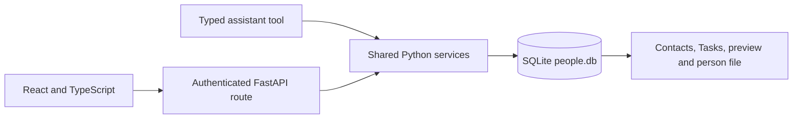
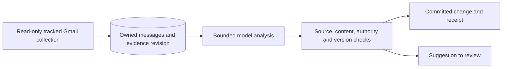
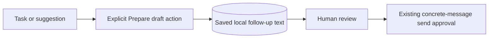

# Contacts attention and shared tasks

Contacts answers who needs attention, why, and what to do next. Its people table
contains Open, In conversation and Done sequences. Its Tasks view includes all
live saved people, including people kept before outreach. A task never changes
sequence membership. Companies remain context on people.

## Follow one edit through the application

`crm_tasks.py` owns task validation, lifecycle, versions and retry receipts.
`crm_service.py` owns descriptions, manual flags, suggestions and scoped undo.
`crm_tools.py` adapts assistant calls to these services. HTTP request bodies
cannot choose the execution actor. Direct chat edits protect human wording
while retaining the assistant as execution actor in the receipt.

SQLite transactions save a record, its change history and its operation receipt
together. An operation ID identifies an intention, not an attempt: retrying the
same ID and arguments returns the saved result. Reusing it with different
arguments conflicts. Expected versions prevent overwriting newer records.

## Attention and interface

Attention ranks attribution review, manual flags, overdue tasks, tasks due today,
incoming replies to review, then suggestions. The nearest action is the earliest
dated open task, or the oldest undated task. Suggestions never replace committed
work. Due dates keep their saved IANA timezone; changing operator settings does
not silently move existing deadlines. Manual flags expire after their local
until-date and never hide overdue work.

React reuses `Tasks`, `DescriptionEditor` and `MailActivity` in the preview.
Selecting a person keeps the table mounted. Narrow windows show the inspector
with a back control. Closing or switching a preview with unsaved work offers
continued editing or deliberate discard. Descriptions keep their existing
durable draft buffers. Restoring person snapshots preserves authority and uses
monotonic description versions; task history is independent of person revert.

Local task reads refresh while mounted and support additional pages. Global
suggestions have a separate review section. Source email links and analysis
freshness stay visible. Failed loads retain the last loaded data.

## Background evidence and AI

`crm_analysis.py` uses the existing provider and settings, without agent runs or
connector write tools. The FastAPI lifespan owns maintenance and cancellation.
Mail collection runs on startup, on request and at a five-minute cadence. Opening
Contacts requests a check when its previous success is more than one minute old.
Overlapping requests share one refresh. Synchronous Gmail I/O runs through
`asyncio.to_thread`; model calls run outside database write transactions.

Latest and analyzed evidence revisions are saved independently. Pending work
survives restart. Failures use bounded backoff, three attempts per revision and
an explicit Retry afterward. Per-attempt status and usage are retained in
`crm_analysis_attempts`, without copying message bodies or prompts. Cancellation and interrupted attempts remain
restartable. Provider exception text is not persisted because it may contain
credentials or message bodies. Bounded model usage is saved with analysis state.

Automatic changes require owned, complete evidence and unquoted supporting
text. Explicit ISO or named-month dates with a year can be resolved; ambiguous
dates remain suggestions. Task fulfillment must match the actual task and its
tracked conversation. Human-protected fields remain protected. Dismissed or
undone interpretations cannot reappear from unchanged evidence.

## Draft preparation and sending

`crm_drafts.py` prepares local text and a durable artifact without Gmail writes.
An email address is not required. New-message text can be copied into the
existing outreach review panel. The current connector cannot preserve a reply
thread through this preparation path, so replies stay local with a visible copy
fallback. Preparation never marks a task complete or sends anything.

## Learning map: reuse these ideas in another project

| Tool or idea | Scenario and application |
| --- | --- |
| React state and effects | Keep unsaved keystrokes separate from saved facts. Effects load records and subscribe to changes; cleanup removes timers/listeners and ignores late responses after navigation. |
| TypeScript and API contracts | Types catch incorrect frontend assumptions. Runtime validation is still needed because a caller can send data without using the frontend. |
| FastAPI and a shared service | A button and an assistant can perform the same action. Both call one business-rule implementation, so one cannot bypass the other's checks. |
| SQLite transactions | A crash between saving a task and saving its receipt must not leave half a change. Commit both together. |
| Versions and operation IDs | Versions prevent stale overwrites; operation IDs prevent duplicate retries. These solve different problems and are useful together. |
| asyncio and checkpoints | Background execution keeps the UI responsive; saved checkpoints make work survive restart. An in-memory task alone provides no durability. |
| pytest and Testing Library | Test outcomes with a real local database and fake external boundaries. UI tests interact through labels and roles, which also exercises accessibility. |

## Storage and verification

Schema 7 is registered in the migration registry, with existing backup/rollback
behavior. It extends CRM change kinds, adds proposals, interpretation suppression
and reply-review dismissals, and saves attention and analysis state. Migration
does not generate AI summaries or invent tasks.

See [the implementation verification record](../verification/2026-10-22-contacts-attention.md).
Synthetic fixtures verify structural gates, not real-world interpretation
precision. Consented examples and native macOS checks remain necessary before
release certification.

Implementation references: [FastAPI lifespan](https://fastapi.tiangolo.com/advanced/events/),
[Python background I/O](https://docs.python.org/3.14/library/asyncio-task.html#asyncio.to_thread),
[SQLite transactions](https://www.sqlite.org/lang_transaction.html), and
[React effect cleanup](https://react.dev/reference/react/useEffect).
