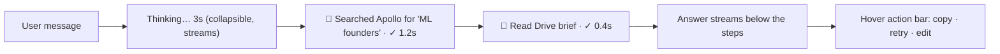

# Sourcecado agent UI audit (2026-10-12)

Scope: the agent surface of the desktop app, from app shell down to streaming components.
Method: code read of `frontend/src/app` and `frontend/src/chat`, plus a live run of the real UI
against a local mock model (`scratchpad/tools/mock_llm.py`) because both dev provider keys return 401.
Screenshots live in `refs/ours-*.jpg`. Board: `docs/evidence/agent-ui-refs/index.html`.

## Verdict

The shell is an accessible, well-engineered skeleton. It does not read as a modern GTM agent.
Six things cause most of the gap:

1. **Nothing renders for the first seconds of a run.** Reasoning and tool-call deltas arrive, the transcript stays blank, only a header timer moves.
2. **Reasoning never reaches the UI.** The backend receives reasoning deltas and drops them (`backend/coworker/turn.py:1173`).
3. **Tool activity sits below the answer, collapsed.** Cause is shown after effect. Rows carry no icon, no argument summary, no result preview.
4. **No icons anywhere.** Nav links are words. Actions are glyphs (✎ ○ ● ☰ ×). Ten buttons in the chat surface are text only.
5. **Operator telemetry lives in the header at 11px gray.** Six stats, always on, plus a second budget line that flashes during the run.
6. **Small gray text is the default voice.** `chat.css` has 28 muted-color rules, 15 at 12px, 9 at 11px.

## Run timeline, observed vs target

```mermaid
gantt
    dateFormat  s
    axisFormat  %Ss
    title Observed run (mock model, 1440px)
    section Backend
    reasoning deltas        :a1, 0, 3s
    tool calls now + board  :a2, 3, 2s
    reasoning + answer      :a3, 5, 5s
    section What the operator sees
    blank transcript, header timer only :crit, b1, 0, 5s
    answer streams, then activity row appears below it :b2, 5, 5s
```

Target (what Claude.ai, Clay and Attio do, to be proven on the board):

## Findings by layer

### A. App shell

| # | Finding | Evidence | Where |
|---|---|---|---|
| A1 | Rail destinations are text-only; no icons, no collapse to icon rail | `ours-empty-thread-1440.jpg` | `app/GlobalRail.tsx` RailLink |
| A2 | Thread actions are Unicode glyphs (✎ pin ○/●), always visible, 12px muted | same | GlobalRail ThreadRow |
| A3 | Account footer is a placeholder ("Operator / Sourcing Director", "SD") | same | GlobalRail |
| A4 | At 390px the rail renders open over the thread on load (observed once; verify) | `ours-rail-390.jpg` | shell.css off-canvas rules |
| A5 | Header carries an eyebrow ("SOURCING WORKSPACE", 11px mono), a persona badge, and six telemetry stats at 11px muted | `ours-run-complete-1440.jpg` | `chat/ThreadHeader.tsx`, `RunMetrics.tsx` |
| A6 | Title auto-naming shows in the rail during the run but the header title updates only after reload | run vs reload shots | `routes/ChatPage.tsx` sets title only in `loadThread` |
| A7 | Empty thread offers one suggested prompt as a chip; no cards, no recent targets | `ours-empty-thread-1440.jpg` | `chat/ThreadView.tsx` |

### B. Key interactions

| # | Finding | Evidence | Where |
|---|---|---|---|
| B1 | Blank transcript while reasoning and tool calls stream; only the header elapsed timer moves | `ours-run-streaming-blank-1440.jpg` | ActivityGroup renders inside AssistantMessage; no pre-text placeholder |
| B2 | Reasoning deltas are dropped before they reach the socket | code | `turn.py:1173` `if chunk.kind is StreamKind.REASONING: continue` |
| B3 | Activity group renders after the prose, collapsed, summary is a text-only button, elapsed reads "0s" | `ours-run-complete-1440.jpg` | `chat/ActivityGroup.tsx` |
| B4 | Run budget line ("Step 1 of 40 · 2 of 120 tool calls · $0.0005 of $2.00") flashes mid-run then disappears; duplicates header stats | `ours-run-streaming-text-1440.jpg` | `chat/RunBudget.tsx` |
| B5 | Approval card label is past tense before anything happened ("Deleted person file"); "consequential: waits for Allow or Deny" is policy jargon; args shown as raw JSON; Deny / Allow once are text-only | `ours-approval-card-1440.jpg`, `ours-approval-expanded-1440.jpg` | `chat/ApprovalCard.tsx`, `toolRegistry.tsx` labels |
| B6 | After Deny the same action gets two receipts: "Denied" (12px muted) then "Failed" (red) | `ours-approval-denied-1440.jpg` | ActivityGroup partState + group receipt |
| B7 | Composer has no attach/context menu, no skill or model picker, no slash commands; a narrating sentence sits under it at 11px muted | `ours-run-streaming-blank-1440.jpg` | `chat/Composer.tsx` |
| B8 | Message actions = one 12px muted text link ("Copy response"); no retry, edit, or feedback | `ours-run-complete-1440.jpg` | `chat/AssistantMessage.tsx` |
| B9 | Failed-turn notice has no action (no Retry button) | `ours-failed-turn-1440.jpg` | AssistantMessage noticeFrame |

### C. Detailed components

| # | Finding | Evidence | Where |
|---|---|---|---|
| C1 | Tool row = label + "Inspect" text button + bold state word on the right; no icon, no argument summary, no inline result | `ours-activity-expanded-1440.jpg` | ActivityGroup ActivityRow |
| C2 | Inspector shows "TOOL DETAIL" eyebrow, epoch-ms timing ("1791859333227–1791859333235"), and raw JSON inside two `
`; Close is a text button | `ours-inspector-1440.jpg` | `chat/Inspector.tsx` |
| C3 | Structured result renderers exist (Apollo people, Gmail draft, Calendar, Living brief, Evidence set) but are gated on tool slot and were not reachable in this run | code | `chat/toolRegistry.tsx`, `generative/*` |
| C4 | Source citations render as plain links; no favicon chip | code | `chat/SourceCitation.tsx` |
| C5 | Only two SVG icons exist in the chat + app folders (send arrow, suggestion arrow) | grep | `frontend/src/chat`, `frontend/src/app` |

## Rule check against Fisher's rules

| Rule | Status | Count |
|---|---|---|
| No text-only buttons | Fails | 10 in chat + app TSX |
| No small gray text | Fails | 28 muted rules, 15 × 12px, 9 × 11px in chat.css |
| No field labels | Passes | composer and rename use placeholders |
| No narrating sentences | Fails | "You can keep drafting while Sourcecado works.", "Cached conversations may be stale." |

## What is good and should stay

- Keyboard and screen-reader work: focus trap on the rail, inert off-canvas sheet, live region for run state, Escape closes inspector and rail.
- Draft persistence per thread, queue of follow-up messages, recovery actions on tool failure (retry / repair / continue without).
- Domain result renderers already exist for Apollo, Gmail, Calendar, briefs, and evidence sets.
- Warm Operator tokens: cream canvas, avocado accent, General Sans. The palette is right; the chrome is not.

## Not in this audit

- Contacts, Person file, Scheduled, Connections, Settings pages: out of scope (agent surface only).
- A real provider run: both dev keys (DeepSeek, Moonshot) return 401. The mock reproduces reasoning, tool calls, approval, and text streaming through the real backend and socket.
- Dark mode: not captured; `prefers-color-scheme` tokens exist in `styles/tokens.css`.

## Reference picks (board: `index.html#refs`)

Products: Claude.ai (plus Claude Code and the Managed Agents console), Clay, Attio. 80 images, 22 recorded gaps.

| # | Component | Pick | Why | Gap |
|---|---|---|---|---|
| 1 | Sidebar / rail | **Attio** `attio-rail` (full shell), Claude `claude-rail` for the collapsed icon rail, `claude-rail-2` for threads grouped by Needs input / Working / Completed | Icon + label rows, ⌘K quick actions, counts, pinned views with hover actions, account footer | No image of hover actions on a favorites row |
| 2 | Thread header | **Attio** `attio-header-2` (record chips + tabs); Claude `claude-header-2` for the agent console metrics chip | Context chips and tabs replace our eyebrow + persona badge; metrics move into one chip | No model badge or overflow menu image from Claude |
| 3 | Empty thread | **Claude** `claude-empty` (greeting, composer, four icon prompt chips); Clay `clay-empty` for icon-tile cards | Composer-first, several suggested starts | — |
| 4 | Composer | **Claude** `claude-composer-2` (send → stop square, "Queue another message", mode chip); Attio `attio-composer` for the slash menu | Matches our existing queue; adds skill and model entry points | No "+" connectors menu image, no keyboard-hint image |
| 5 | Thinking disclosure | **Claude** `claude-thinking` ("Thinking…" → "Thought for 31 seconds" + first line, chevron) | The exact streaming state we lack; needs the backend to forward reasoning deltas | Clay has none; Attio shows reasoning only after the fact (`attio-thinking-2`, good for a receipt) |
| 6 | Tool step row | **Claude** `claude-toolstep` (provider logo + "Searched recent events" + "4 results" + chevron); Clay `clay-toolstep` for check → spinner → pending list | Verb + object + count on one row; grouped rows in `claude-toolstep-2` | Running label is muted in Claude; use full ink |
| 7 | Structured results | **Claude** `claude-resultcard` (search and record cards) and `claude-resultcard-2` (Drive file card); Clay `clay-resultcard` for waterfall with provider logos; Attio `attio-resultcard` for the person card | We already have Apollo, Gmail, Calendar renderers; copy card chrome and source chips | No favicon citation chip image |
| 8 | Side panel / inspector | **Claude** `claude-sidepanel-2` (Progress / Outputs / Context tabs); Clay `clay-sidepanel` for credit cost in the inspector | Tabs replace our two raw JSON details blocks | No resize handle image |
| 9 | Approval | **Attio** `attio-approval` (review table of changes, "Update (5) ⌘↵", Discard); Claude Code `claude-approval` for the Allow / Deny prompt; Clay `clay-approval` for cost-aware confirm | Shows what will change before it changes; cost line fits Apollo credits | No resolved-receipt image anywhere |
| 10 | Usage / cost | **Claude** `claude-usage` (status line: context bar + cost); Attio `attio-usage-2` per-action credits line | Quiet, one line, not six header stats | No plan-limit bars image |
| 11 | Error + recovery | **Attio** `attio-error-2` (retry menu) and `attio-error` (failed step); Clay `clay-error` for cell-level "Not found" | Retry is one click on the failed step | Claude has no error image on allowed hosts |
| 12 | Message actions | **Claude** `claude-actions` (Copy / Retry / thumbs bar); Attio `attio-actions-2` for assistant messages | Icon buttons, appear on hover under the message | No Edit action image |

Caveats from the agents: pixel sizes in the "Steal this" specs are estimates from marketing renders; five Claude images are single frames cut from official product-page videos (listed in `manifest.json` with the frame time); Claude help-center screenshots on the Intercom CDN were skipped because the host was not on the allow-list.

Not copied from the references (they break our rules): Claude's 11–12px gray footers and "Last edited" lines; Clay's text-only "Cancel"; Attio's muted "Attribute / New value" column labels.
