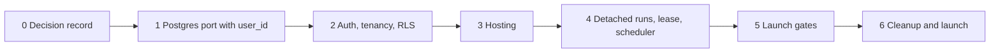

# Hosted migration: phased plan

Date: 2026-11-09. Version 2, after review. Reviewer of record: Fisher.
Spec: `docs/superpowers/specs/2026-11-09-hosted-migration-spec.md`. Decision numbers refer to the spec's decision table.

Review: Codex (`gpt-6-sol`, read-only sandbox) reviewed version 1 against the repository and made 18 findings. Each finding was then checked against the code. All 18 were factually correct, and all 18 changed this plan or the spec. Twelve are applied as proposed. Two (13, 14) are applied with a smaller fix than Codex proposed. Four (3, 8, 10, 18) are applied in part. The record is at the end of this file.

No time estimates are in this plan. The spec lists measured counts.

## Phase map

## Rules for all phases

- Each PR leaves main with green tests.
- One store or one concern for each PR. No PR mixes a port with a behavior change.
- Each store has one persistence backend at a time. There is no runtime flag for SQLite or Postgres.
- After phase 0, main is not a working desktop product. Desktop users and the cohort use the `desktop-final` tag.
- A "Verify" cell must fail when the task is done wrong. A check that passes in both cases is not a check.
- If a secret value appears in code, a commit, or a log, stop work and tell Fisher.

## Decisions Fisher must confirm

The review changed four things that touch a settled decision or need a number. Each has a default so that work is not blocked.

| # | Question | Default in this plan | Alternative |
| --- | --- | --- | --- |
| A | When are `doctor.py` and `migrations.py` deleted? Decision 15 said the final PR. | End of phase 1 (task 1.16). Their tests need the SQLite stores, so they cannot stay green through phase 1. | Keep them to phase 6 and skip their tests. Not recommended: skipped tests hide the dead code. |
| B | How many concurrent runs for each user? | 2 (task 3.4). | 1, which is the safest for spend. |
| C | Are user skills and per-user MCP settings in the launch? Decision 19 said yes. | Yes (task 1.13). It is the first item to cut. | Codex proposes to defer it: ship built-in skills and the fixed Granola endpoint only. |
| D | When does the spend cap land? | Phase 5. Until then, staging allows only Fisher and one test account that Fisher controls, and the per-run budget of 2.00 USD applies. | Codex proposes before the first staging deploy. |

## Phase 0: Decision record

Goal: the repository says that hosted is the product direction.

| # | Task | Verify |
| --- | --- | --- |
| 0.1 | Land or stash the 12 uncommitted files in the working tree. | `git status` shows no modified tracked files. |
| 0.2 | Tag the last desktop commit as `desktop-final` and push the tag. | `git ls-remote --tags origin desktop-final` prints the tag. |
| 0.3 | Write ADR 0007, "Hosted web service replaces the local desktop app". It supersedes ADR 0002 and ADR 0003. | The file is in `docs/engineering/adr/`. |
| 0.4 | Update `AGENTS.md`: product direction, guardrails, repository map. Remove the "do not reintroduce hosted" line. Keep "never add auto-send" and the secrets rule. | A reader of `AGENTS.md` finds no instruction to build a desktop app. |
| 0.5 | Add the spec and this plan to the precedence list in `docs/README.md`. Update `README.md`. | Links resolve. |
| 0.6 | Fisher picks the domain name and answers questions A to D above. | The answers are in the ADR. |

Exit: ADR 0007 is merged, and the tag exists.

## Phase 1: Postgres port with `user_id`

Goal: all persistence is in one local Postgres database. Each table has `user_id`. The app runs for one fixed development user. Nothing is hosted.

### 1A. Foundation (one PR)

| # | Task | Verify |
| --- | --- | --- |
| 1.1 | Add `supabase/` with the Supabase CLI. Add `make db-up` and `make db-reset`. | `make db-reset` gives a database with all migrations applied. |
| 1.2 | Add `backend/coworker/db.py`: a `psycopg` 3 connection pool and a `tx(user_id)` context manager. `tx` opens a transaction and sets `app.user_id` for that transaction only. | A test reads `current_setting('app.user_id')` inside `tx`. A second test reads it after `tx` ends and gets no value. |
| 1.3 | CI: add a Postgres service container. A CI-only bootstrap file creates a minimal `auth.users` table, because the migrations have a foreign key to it. | On a new CI database, every migration applies, and an insert of one user-owned row succeeds. |
| 1.4 | Test fixture: each test gets a clean database and a `make_user()` helper that inserts an `auth.users` row. The unit of isolation inside one test changes from "a state directory" to "a user". | `test_run_budget_mutations.py` passes with its two stores as two users in one database. Two tests that write the same key do not affect each other. |
| 1.5 | Seed one fixed development user. Callers pass its id until phase 2. | The app starts on an empty local database and creates a session. |

Choices:

- Synchronous `psycopg` with a pool, not `asyncpg`. The stores are synchronous and are called through `asyncio.to_thread`.
- A CI stub for `auth.users`, not the full Supabase stack in CI. CI needs one container, and the RLS design uses `app.user_id` and does not use Supabase roles. Local development uses the Supabase CLI, which has the real table.

### 1B. Port the stores (one PR for each row, in this order)

| # | Store | Why this position | Verify |
| --- | --- | --- | --- |
| 1.6 | `agent_run_repository.py` (`agent_runs.db`) | Smallest schema, most concurrency, best tests. It proves the locking translation first. | `test_agent_run_*.py` pass on Postgres, including leases and restart. |
| 1.7 | `people.py`, `crm_*`, `crm_tasks.py`, `crm_reminders.py` (`people.db`) | The durable domain object. | `test_crm_*.py` and `test_people*.py` pass. |
| 1.8 | `store.py` (`club.db`) | The largest store (2011 lines). Split into two PRs if the diff is too large to review: sessions, events, memories; then jobs, inbox, queue. | The remaining `store` tests pass. |
| 1.9 | `drive_ingestion.py` | Independent. | `test_drive_ingestion*.py` pass. |
| 1.10 | `meeting_evidence.py` | It calls the people store after its own commit (`meeting_evidence.py:470`), so it follows 1.7. | `test_meeting_evidence*.py` pass. |

No SQL statement joins two of the SQLite files today (no `ATTACH`). The order above is therefore safe.

Steps for each store PR:

1. Write one migration file with the head schema of that store. Do not replay the SQLite migration history. Add `user_id uuid not null references auth.users(id) on delete cascade` and an index to each table. Add `user_id` to per-user unique keys.
2. Translate the SQL with the rules in the spec. Review each `BEGIN IMMEDIATE` site by hand.
3. Change each public function to take `user_id`, and add `WHERE user_id = %s` to each query.
4. Remove that store's entries from `migrations.py` and its checks from `doctor.py`. Delete the doctor and migration tests that cover that store.
5. Move that store's tests to the Postgres fixture.

### 1C. File state and leftovers

| # | Task | Verify |
| --- | --- | --- |
| 1.11 | Move JSONL transcripts and event logs to tables. | The session load and replay tests pass. No `.jsonl` file is written in a test run. |
| 1.12 | Remove the `memory/` markdown mirror. | The memory route tests pass. No `memory/` directory is created. |
| 1.13 | Move `mcp.json` and user skills to per-user rows. First item to cut; see question C. | The skills and MCP tests pass with two users who have different skills. |
| 1.14 | Port the evals harness. Each evaluation gets a new user in the test database. Today each gets a new state directory (`evals/environment.py:231-240`). | `python -m coworker.evals --suite sourcing` is green, and no `.db` file exists under the artifact directory. |
| 1.15 | `secret_scan.py` reads SQLite files (`secret_scan.py:57, 191, 282`) to confirm that a revoked secret is absent from conversations and events. Port that scan to the Postgres tables. If a table is not covered, the result must say "incomplete", not "absent". | A test stores a secret value in a ported row, and the scan reports it. The module has no `sqlite3` import. |
| 1.16 | Delete `doctor.py`, `migrations.py`, and their remaining tests. See question A. | `make doctor` no longer exists. CI is green. |

Exit for phase 1:

- `pytest -q` is green on Postgres.
- `python -m coworker.evals --suite sourcing` is green.
- `grep -rn "import sqlite3" backend/coworker` returns nothing.
- `make backend` plus `make gui` runs the app locally against local Postgres.

## Phase 2: Auth, tenancy, RLS

Goal: two accounts can use one local backend. Neither can read the other's data, use the other's Google account, or receive the other's events.

| # | Task | Verify |
| --- | --- | --- |
| 2.1 | Read the current Supabase docs for JWT verification and for the before-user-created hook. Record both methods in the PR. | The PR cites the doc pages. |
| 2.2 | Replace the `gate` middleware with a global auth middleware: verify the JWT, check the allowlist, attach the user id to the request. It stays global. Exceptions: `OPTIONS`, the two OAuth callbacks, the health route. In the same PR, add a route-inventory test that walks `app.routes`, including mounted routers. | Each HTTP route outside the exception list returns 401 with no token. A new route with no auth makes the test red. |
| 2.3 | Add `allowed_emails`: no `user_id`, read-only for the backend role, written by the operator only. Add a Supabase before-user-created hook that refuses an email that is not listed. Keep the backend check for a user whose access was removed later. | A Google account that is not listed cannot create an `auth.users` row. A valid token for an email that was removed from the list gets 403. An insert by the backend role fails. |
| 2.4 | WebSocket: verify the JWT from the `Sec-WebSocket-Protocol` list. Remove the `?token=` path. | A socket with no token closes with code 1008. A socket with the token in the query string also closes. |
| 2.5 | `user_secrets` with AES-GCM. Keep the `SecretStore` interface and change its backend. | A raw row read shows no token text. A wrong key fails to decrypt. User B cannot read user A's secret through the interface. |
| 2.6 | Per-request user context. Replace the fixed development user with the real user id. Make the `app.state.*` stores stateless. | No route reads a store that is bound to one user. |
| 2.7 | User-scoped connectors. Build Gmail, Drive, Calendar, Granola, Monid, the connector probes, and CRM refresh for each user from that user's grants. Use them in routes, in runs (`server.py:4014-4026`), and in scheduled jobs. Remove the process-wide instances (`server.py:499-532`, `2228`). | Two users with two different fake Google grants: a read, a draft, and an approved send by user A use A's grant only. User B with no grant gets "not connected" while A is connected. |
| 2.8 | Scope in-memory state by user: `live_event_senders` and `RunCoordinator`. `_publish_live_events` sends only to the owner's sockets. Give the telemetry adapter a size bound. | Two sockets for two users: B receives no event of A. After many runs, the adapter's record count stays under the bound. |
| 2.9 | Add an RLS policy to each table. Create the backend role without `BYPASSRLS`. Add the lookup functions for operations that have no user yet (spec, "Lookups that have no user yet"): `security definer`, fixed `search_path`, ids only. | A query with the wrong `app.user_id` and no `WHERE` clause returns zero rows. Each lookup function returns no content column. The OAuth callback and the scheduler tests pass with the backend role. |
| 2.10 | RLS coverage check in CI. It reads the catalog. `allowed_emails` is the one named exception. | Removing one policy in a scratch branch makes CI red. |
| 2.11 | Two-user gate test. It reads the route list from the app and fails on a route with no case. It runs in two modes: with the backend role, and with a role that bypasses RLS. The second mode tests the `WHERE user_id` filters alone. | Removing one `WHERE user_id` in a scratch branch makes the bypass-mode run red. |
| 2.12 | OAuth connect state in `oauth_pending` rows: user id, provider, `state`, PKCE verifier, expiry, used flag. The callback finds the user from the row. Callback error pages show fixed text. | Two users start a connect at the same time, and both finish. A replayed `state`, an expired `state`, and an unknown `state` are each rejected. The error page contains no provider error text. |
| 2.13 | Seed per-user defaults at first sign-in: the weekly job and settings. | A new user has one default job. A second sign-in does not add a second job. |
| 2.14 | Frontend: add `@supabase/supabase-js`, a sign-in screen, session handling, and sign-out. Put the `Authorization` header in one fetch wrapper and remove the `X-Club-Token` call sites and the `window.__CLUB_*` paths. | `npm test` is green. Manual check with two Google accounts on a local stack. |
| 2.15 | Frontend: add the user id to each `localStorage` key that holds content, and clear those keys on sign-out. Files: `app/sessionCache.ts`, `chat/draftStorage.ts`, `descriptionDrafts.ts`, `followUpDrafts.ts`, `crm/PersonDetailsEditor.tsx`, `EnrichmentPanel.tsx`. | A test: user A writes a draft and signs out, user B signs in, and B's storage reads return nothing of A's. |

Order inside the phase: 2.5 comes before 2.7, because connectors read per-user secrets. 2.2 comes before all other tasks.

Exit: the route-inventory test, the two-user gate in both modes, and the RLS coverage check are green in CI.

## Phase 3: Hosting

Goal: staging runs on Vercel, Railway, and Supabase with a public URL.

### 3A. Must merge before the first deploy

| # | Task | Verify |
| --- | --- | --- |
| 3.1 | Remove the workspace file tools, the shell tools, the folder picker, and their UI and state files (decision 10). This includes the dispatch branch in `tools.py:650`, which is separate from the advertised catalog. | A direct `execute("shell_exec", ...)` returns "unknown tool". `import coworker.workspace_shell` fails. `grep -rn "WORKSPACE_TOOL_NAMES" backend` returns nothing. |
| 3.2 | Remove the loopback bind refusal (`run.py:83`), the parent-death watcher, and the token file. Read CORS origins from `ALLOWED_ORIGINS`. | The backend starts on `0.0.0.0:$PORT`. A request from an origin that is not listed is refused. |
| 3.3 | OAuth: read `PUBLIC_URL`. Return the authorization URL to the frontend. Remove the `open` command. | The connect flow works locally with `PUBLIC_URL` set. No `subprocess` call opens a browser. |
| 3.4 | Request limits: a size limit for request bodies, a size limit for WebSocket frames, and a limit of 2 concurrent runs for each user (question B). | An oversized JSON body gets 413. An oversized frame closes the socket. A third concurrent run is refused with a clear message. |

Rate limits by IP address are not in this plan. All routes except the two callbacks and the health route need a valid token for an allowed email. Add them before open signup.

### 3B. Infrastructure

| # | Task | Verify |
| --- | --- | --- |
| 3.5 | Confirm the network path from Railway to Supabase Postgres and the `psycopg` settings for it. Confirm Supabase plan terms for backups. Confirm the Python 3.14 image. Confirm how Railway signals a deploy to the old container. | The findings are in the PR. |
| 3.6 | Add a `Dockerfile` for the backend and a health route. | `docker build` and `docker run` pass the health check locally. The image file list has no workspace or shell module. |
| 3.7 | Create the staging Supabase project. Apply migrations. Create the private attachments bucket. | `supabase db push` reports no pending migration. |
| 3.8 | Move attachments to Supabase Storage. The backend builds the key as `user_id/attachment_id` from the signed-in user. | User B gets 404 for user A's known attachment id on read, on text, and on delete. |
| 3.9 | Create the Railway project with a staging environment, one replica. Set the variables by name from the spec. | The health route answers on the Railway URL. |
| 3.10 | Create the Vercel project: root `frontend/`, build `npm run build`, output `dist`. Add security headers in `vercel.json`. | The staging UI loads and shows the sign-in screen. |
| 3.11 | Point `app.` and `api.` at Vercel and Railway. | `https://api.<domain>/health` answers. `wss://api.<domain>/ws/chat` connects after sign-in. |
| 3.12 | Create the staging Google Cloud project and OAuth client. Set publishing status to In production. Add the redirect URIs. | Gmail connects on staging. Start the 8-day refresh-token check and write the start date here. |
| 3.13 | GitHub Actions: on merge to main, run tests, apply migrations to staging, then deploy. Add a manual promote workflow for production. | A merge deploys staging with no manual step. |

Fisher does these steps by hand, because they need account credentials: create the Supabase, Railway, Vercel, and Google Cloud projects, and enter the secret values. Until phase 5, `allowed_emails` on staging holds two entries: Fisher's email, and one test account that Fisher controls. The test account is for the two-user smoke step.

Exit: a chat run completes on staging with the mock provider, then with a real provider.

## Phase 4: Detached runs, lease, scheduler

Goal: the agent works with no browser open.

| # | Task | Verify |
| --- | --- | --- |
| 4.1 | Move run ownership from the socket handler to a process-level registry. Remove offline parking for the no-window case. | Start a run, close the socket, and the run reaches a final state with all events stored. |
| 4.2 | Replace `flock` ownership with a lease row: owner id, expiry, heartbeat. Delete the marker files in `agent_run_owner.py`. | `test_agent_run_leases.py` passes with two simulated owners on one database. |
| 4.3 | On the deploy signal, stop new runs and mark active runs as interrupted. Do not wait for them; a run can last 15 minutes. Keep the startup reconcile. | Stop the container during a run. The run shows interrupted. No effect is dispatched two times. |
| 4.4 | Scheduler: read due jobs for all users. A job runs only after a database claim on its row. The tick and "Run now" use the same claim, and the claim expires. This replaces the process-local set (`scheduler.py:190`). The job runner sets the user context. | A tick and a "Run now" from two scheduler instances on one database give one execution. A claim left by a killed process expires, and the job runs again. |
| 4.5 | `crm_refresh`: loop over users with a connected Google account, with the user-scoped connectors from 2.7. One user's failure does not stop the loop. | One failing user and one healthy user: the healthy user's refresh completes. |
| 4.6 | Frontend: reconnect after a dropped socket, load stored events on open, and show the interrupted state with a retry action. | Three cases on staging, each with events in order and no duplicates: (a) close the tab during a run and open it again; (b) open the session in a new browser profile with no local state; (c) restart the backend during a run, then open the session. |

Note for 4.6: the socket replay reads the in-memory coordinator (`server.py:4175`), which is empty after a restart. The frontend resync covers only sessions that this browser instance tracked (`api.ts:2841`). Cases (b) and (c) test the paths that these two do not cover. If either fails, add a load of stored events by cursor.

Exit: on staging, a scheduled job completes with no browser open, and case (c) passes.

## Phase 5: Launch gates

Goal: each line of the spec's launch-gate list is true on staging.

| # | Task | Verify |
| --- | --- | --- |
| 5.1 | `user_spend` and the monthly cap. One SQL statement reserves the maximum that the call can cost, only if the total stays under the cap. After the call, replace the reservation with the real amount. Release it when the call fails before dispatch. Settle it at its maximum when it expires unsettled. Cover LLM requests, `web_search`, `apollo_search_people`, and Apollo enrichment. Refuse a model with no price entry. Show the remaining amount and a clear stop message. | A user with a cap of zero cannot start any of the four call types. Two concurrent calls, with room for one, give one call and one refusal. A call whose maximum does not fit is refused, even when a typical cost would fit. An unsettled reservation counts at its maximum after expiry. |
| 5.2 | Import script: one state directory, one user email, dry-run mode, row counts, safe to run two times. It imports the attachments that imported transcripts refer to. | Import Fisher's local data to staging. The counts match the SQLite counts. A second run adds zero rows. An imported message opens its attachment. |
| 5.3 | Delete-account, in this order: remove the allowlist entry, revoke the Google grant, delete the Storage objects, delete the Supabase Auth user. The rows go with the Auth user through `ON DELETE CASCADE`. | A count of rows for that `user_id` over all tables is zero. The Storage prefix is empty. The old identity gets 403 at sign-in. |
| 5.4 | Data notice at first sign-in. | A new user sees it one time. |
| 5.5 | Sentry on backend and frontend with the scrubber. | A test raises an error that contains a fake token and a fake mail body. The captured event contains neither. |
| 5.6 | Create the production Supabase project, Railway environment, and Google Cloud project. | The promote workflow deploys production. |

Exit: all launch gates except the parity run are checked.

## Phase 6: Cleanup and launch

| # | Task | Verify |
| --- | --- | --- |
| 6.1 | Delete `frontend/src-tauri/`, `backend/packaging/`, `update_channel/`, the diagnostic bundle, the macos-preview CI job, and the related Makefile targets. | CI is green. `grep -rn "tauri" frontend/src` returns nothing. `grep -rn "sqlite3" backend/coworker` returns the import script only. |
| 6.2 | Update `CONTRIBUTING.md` and `docs/engineering/`. Retire `packaging.md`, `update-channel.md`, `doctor.md`, and `diagnostic-bundle.md`. | A new contributor can run the stack from the docs. |
| 6.3 | Parity run in production with Fisher's account. | Each step of the parity list has a run-ledger entry. |
| 6.3a | Import Fisher's local data to production. | The count report matches the SQLite counts, and five person files match the desktop app. |
| 6.4 | Fisher uses production alone for one week. | No open isolation or spend defect. |
| 6.5 | Import the director's data and invite the director. | The director confirms their person files. |
| 6.6 | Invite the other officers through `allowed_emails`. | Each invited user completes one run. |

The untracked `desktop/` directory holds only stale caches. Fisher decides whether to delete it.

## What stops the plan

| Finding | Action |
| --- | --- |
| The staging refresh token fails before 8 days. | Stop the rollout. Decide between Internal user type and verification. |
| A `BEGIN IMMEDIATE` site has no safe Postgres translation. | Stop that store PR. Write the options for Fisher. |
| The two-user gate or the connector test finds a leak after phase 2. | Fix before any other work. |
| The Railway-to-Supabase path needs a paid add-on. | Report the cost to Fisher before it is bought. |

## Not in this plan

- GitHub issues. Fisher decides the ticket shape after reading this plan.
- Course material updates in `docs/course/`.
- Google OAuth verification.
- Automatic resume of interrupted runs.
- A second replica, a queue, and a worker service.
- Rate limits by IP address.
- An enforced 8-step run limit. `MAX_STEPS` is unused today, and the run budget (40 turns, 15 minutes, 2.00 USD) is the real limit. This plan does not change it.

## Review record

Reviewer: Codex CLI 0.157.1, model `gpt-6-sol`, high reasoning effort, read-only sandbox, 2026-11-09. The first attempt with the configured model `gpt-6.1-sol` failed with "model not supported" and produced no review. Codex did not run tests. It did not check cloud-provider behavior, pricing, or the Google policy claims.

Each finding was checked against the code before it changed this plan.

| # | Finding | Severity | Checked at | Result | Task |
| --- | --- | --- | --- | --- | --- |
| 1 | Gmail, Drive, Calendar, MCP, and CRM refresh are process-wide and are passed to every run. | Blocker | `server.py:499-532`, `4014-4026`, `2228` | Applied | 2.7, 4.5 |
| 2 | Auth as a per-route dependency would miss mounted routers. | Blocker | `server.py:1221-1232`, `508-516`, `2214` | Applied | 2.2 |
| 3 | The spend check is not a hard cap, and it missed web search and Apollo search. | Blocker | `turn.py:1486`, `tools.py:113-150` | Applied in part. The reservation and the four call types are in. The move to before the first deploy is not; see question D. | 5.1 |
| 4 | Attachments are found by id with no owner. | Blocker | `attachments_api.py:101-112`, `attachments.py:349` | Applied | 3.8 |
| 5 | A plain Postgres container has no `auth.users` table for the foreign keys. | Blocker | `ci.yml`, `tests/conftest.py` | Applied | 1.3, 1.5 |
| 6 | Some tests build two stores in one test, and the evals build a state directory for each run. | Blocker | `test_run_budget_mutations.py:44, 58`, `evals/environment.py:231-240` | Applied | 1.4, 1.14 |
| 7 | The phase 1 `grep` for `sqlite3` could not pass while `doctor.py`, `secret_scan.py`, and `crm_reminders.py` remain. | Blocker | 10 modules import `sqlite3` | Applied; see question A. | 1.7, 1.15, 1.16 |
| 8 | The 8-step run cap is not active. | Major | `server.py:221` has no other use; `run_budget.py:43-55` | Applied in part. The spec is corrected. No 8-step limit is added. A concurrent-run limit is added. | 3.4 |
| 9 | `allowed_emails` cannot have `user_id`. | Major | Spec data model | Applied | 2.3, 2.10 |
| 10 | No size limit on JSON bodies or WebSocket frames, and no concurrency limit. | Major | `server.py:1363`, `4221` | Applied in part. Size and concurrency limits are in. IP rate limits are not; the spec records the reason. | 3.4 |
| 11 | `localStorage` keys have no user. | Major | `sessionCache.ts`, `draftStorage.ts`, `descriptionDrafts.ts`, and three more files | Applied | 2.15 |
| 12 | OAuth pending state is one value for the process, and callback errors show provider text. | Major | `server.py:2139`, `2087-2092`, `mcp_oauth.py:105` | Applied. The version 1 test assumed a callback session that does not exist. | 2.12 |
| 13 | The telemetry adapter is an unbounded process-wide list. | Major | `telemetry/adapters.py:46-64` | Applied as a size bound. The telemetry route already checks the session's owner through the store. | 2.8 |
| 14 | The replay check would pass on one live process and miss a restart. | Major | `server.py:4175`, `api.ts:2841` | Applied as two more test cases. A cursor load is added only if they fail. | 4.6 |
| 15 | The tick lock did not cover "Run now". | Major | `scheduler.py:145-198` | Applied. One database claim replaces the advisory lock and the local set. | 4.4 |
| 16 | The tool-removal check tested the catalog and not the dispatch path. | Major | `tools.py:650`, `effective_tools.py` | Applied | 3.1, 3.6 |
| 17 | Delete-account left the login identity and the allowlist entry. | Major | Spec launch gates | Applied | 5.3 |
| 18 | "Inbox waiters" do not exist; the inbox polls the store. User skills and MCP settings could be deferred. | Minor | `inbox.py:131-158`, `mcp.py` | The first part is applied: the row is removed from the spec. The second part is question C. | 1.13 |

Facts that Codex confirmed in the code: the five stores open separate SQLite files with no `ATTACH`; the WebSocket accepts a token from the subprotocol list and from the query string (`server.py:391-396`); restart does not resume runs (`agent_run_resume.py`); the scheduler ticks every 30 seconds (`run.py:110-120`); attachment uploads have a 10 MB limit (`attachments_api.py:43-52`).

Still not reviewed by anyone: the platform facts in the spec's risk table (rows 1, 4, 5, 6, 7), and every test file.
