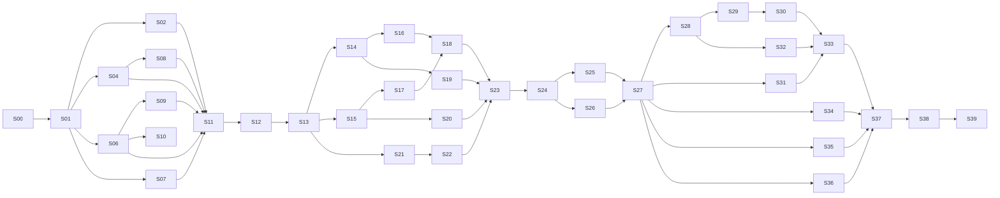

# Hosted migration: executable slices

Date: 2026-11-09. Reviewer of record: Fisher.
Plan: `docs/superpowers/plans/2026-11-09-hosted-migration-plan.md`. Spec: `docs/superpowers/specs/2026-11-09-hosted-migration-spec.md`.

A slice is one pull request. It has one concern, its own tests, and its own QA script. This file cuts the plan's tasks into 40 slices. The plan stays the source for what each task means. This file says how each piece is tested and checked.

## Terms

| Term | Meaning |
| --- | --- |
| Slice | One pull request with one concern. |
| Automated tests | Tests that run in CI. They must fail when the slice is done wrong. |
| QA | Steps that a person or an agent does by hand on a running app, with the expected result for each step. |
| Smoke | The standard QA script below. Most slices run it. |
| Ratchet | A list of exceptions in a test that can only get shorter. The last slice asserts that it is empty. |
| Prep slice | A slice that changes the form of the code and not its behavior. Its check is that no test file changes. |

## Slice contract

Each slice PR contains:

1. The plan task numbers that it covers.
2. New or changed automated tests, and the command that runs them.
3. The pasted tail of the test output, with the pass count.
4. The QA steps, each with the observed result.
5. A list of what the slice does not do.

A slice is done when CI is green, the QA steps pass, and Fisher merges it. Claude does not merge.

## Standard smoke

Run this on a local stack with the mock provider (see `CONTRIBUTING.md`). Use `http://127.0.0.1:5180`.

| Step | Action | Expected |
| --- | --- | --- |
| 1 | `make db-reset`, then start the backend and the GUI. | Both start with no error in the log. |
| 2 | Send one chat message. | The reply streams and completes. |
| 3 | Open Contacts. | The people table loads. |
| 4 | Keep one person. Open the person file. Add one task. | The person and the task show after a page reload. |
| 5 | Open Scheduled. Use "Run now" on the weekly job. | The run completes and shows in the list. |
| 6 | Restart the backend. Reload the page. | The session, the person, and the task are still there. |

From slice S15 on, add step 7: sign in as a second user. Expected: the second user sees none of the data from steps 2 to 5.

## Status

| Slice | State |
| --- | --- |
| S00 | In review |
| S01 | In review |
| S02 to S39 | Not started |

## Order and parallel lanes

Slices with no arrow between them can run at the same time. Two writers must not change the same files at the same time.

## Phase 0

| ID | Slice | Plan tasks | Automated tests | QA | Done when |
| --- | --- | --- | --- | --- | --- |
| S00 | Decision record: ADR 0007, `AGENTS.md`, `README.md`, `docs/README.md`, and these three plan documents | 0.3, 0.4, 0.5 | A script checks that each relative link in the changed files points to a file that exists. | Read `AGENTS.md` with no other context. It must not tell the reader to build a desktop app. The send-approval rule and the secrets rule must still be there. | Fisher merges. Fisher then does 0.1, 0.2, and 0.6: the working tree, the `desktop-final` tag, and the domain. |

## Phase 1: Postgres port

| ID | Slice | Plan tasks | Depends on | Automated tests | QA | Done when |
| --- | --- | --- | --- | --- | --- | --- |
| S01 | Database foundation: `supabase/`, `db.py`, the test fixture, the CI Postgres service, `make db-up` and `make db-reset` | 1.1 to 1.5 | S00 | `tests/test_db.py`: `tx` sets `app.user_id`; the value is gone after `tx`; an error rolls back; two tests that write the same key do not affect each other; `make_user` makes two separate users; migrations apply in file order. | Run `make db-up`, then `make db-reset`, then the tests. Stop the database and run the tests again: they must fail with a clear message and must not be skipped. | CI is green with the Postgres service. No existing test changes. |
| S02 | `agent_runs.db` to Postgres | 1.6 | S01 | All `test_agent_run_*.py` on Postgres. New: two users have separate runs; two connections race for one lease and one wins. | Smoke. Then stop the backend during a run and start it again. The run shows as interrupted, as on `desktop-final`. | `agent_run_repository.py` has no `sqlite3` import. |
| S03 | Prep: portable SQL in `people.py` and `crm_*`, still on SQLite. Optional; do it only if the S02 diff shows that SQL translation is most of the change. | 1.7 | S01 | The existing suite, with zero changed test files. | Smoke. | `git diff --stat` shows no file under `backend/tests/`. |
| S04 | `people.db` to Postgres: `people.py`, `crm_*`, `crm_tasks.py`, `crm_reminders.py`. One slice, because these modules share one connection and one transaction. | 1.7 | S01 (S03 if done) | `test_people*.py` and `test_crm_*.py` on Postgres. New: two users keep a person with the same email; a failed task write rolls back the change row and the receipt row. | Smoke steps 3, 4, and 6. Edit a description, undo it, and check the history. | These modules have no `sqlite3` import. |
| S05 | Prep: portable SQL in `store.py`, still on SQLite. Optional, same rule as S03. | 1.8 | S01 | The existing suite, with zero changed test files. | Smoke. | No file under `backend/tests/` changes. |
| S06 | `club.db` to Postgres: `store.py`. Split into two slices only if no transaction spans the two table groups. Check this first. | 1.8 | S01 (S05 if done) | The `ConversationStore` tests on Postgres. New: two users have sessions with separate events; the first inbox resolution wins under two connections. | Smoke steps 2, 5, and 6. Park one approval, restart the backend, and approve it. | `store.py` has no `sqlite3` import. |
| S07 | `drive_ingestion.db` to Postgres | 1.9 | S01 | `test_drive_ingestion*.py` on Postgres. | Start one Drive ingestion with the fake connector. The job and its proposals show. | No `sqlite3` import in `drive_ingestion.py`. |
| S08 | `meeting_evidence.db` to Postgres | 1.10 | S04 | `test_meeting_evidence*.py` on Postgres. | Attach one meeting to a person. It shows in the person file after a reload. | No `sqlite3` import in `meeting_evidence.py`. |
| S09 | Transcripts and event logs to tables; remove the `memory/` mirror | 1.11, 1.12 | S06 | Session load and replay tests. A test asserts that a run writes no `.jsonl` file and no `memory/` directory. | Smoke step 2, then reload: the full conversation shows. Edit a memory, reload: the edit shows. | A test run leaves no file under the state directory for these. |
| S10 | User skills and `mcp.json` to per-user rows. First item to cut (plan question C). | 1.13 | S06 | Skills and MCP tests with two users who have different skills. | Add a skill in the UI, reload, and use it in a chat. | No skill or MCP file is read from the state directory. |
| S11 | Evals harness on Postgres | 1.14 | S02, S04, S06 to S09 | `python -m coworker.evals --suite sourcing` in CI. A check asserts that no `.db` file exists under the artifact directory. | Read one eval artifact. It has the same sections as before. | The eval job is green in CI. |
| S12 | `secret_scan.py` without SQLite; delete `doctor.py`, `migrations.py`, and their tests | 1.15, 1.16 | S11 | The secret-scan tests. CI runs `grep -rn "import sqlite3" backend/coworker` and fails on any match. | Full smoke. | The phase 1 exit checks in the plan all pass. |

## Phase 2: Auth, tenancy, RLS

| ID | Slice | Plan tasks | Depends on | Automated tests | QA | Done when |
| --- | --- | --- | --- | --- | --- | --- |
| S13 | Global auth middleware, `allowed_emails`, WebSocket JWT | 2.1 to 2.4 | S12 | Route-inventory test: each route outside the exception list returns 401 with no token. An email that is not allowed gets 403 and no row is written. A socket with no token, or with the token in the query string, closes with 1008. The backend role cannot write `allowed_emails`. | With a local Supabase Auth, sign in with an allowed account and with a second account that is not allowed. Use `curl` with no token on three routes. | `X-Club-Token` is gone from the backend. |
| S14 | `user_secrets` with AES-GCM | 2.5 | S13 | A raw row read shows no token text. A wrong key fails. User B cannot read user A's secret. | Read the table with `psql` after a connect. No token is readable. | `secrets.json` is not read or written. |
| S15a | User context: sessions, chat, memory routes. Adds the two-user gate test with a ratchet list of routes that are not yet scoped. | 2.6, 2.11 | S13 | Two-user gate for this route group. The ratchet list is in the test file. | Smoke with step 7 for chat and memory. | The group is off the ratchet list. |
| S15b | User context: people, CRM, task routes | 2.6 | S15a | Two-user gate for this group. | Smoke step 7 for Contacts and person files. | The group is off the ratchet list. |
| S15c | User context: jobs, inbox, runs, run ledger routes | 2.6 | S15a | Two-user gate for this group. | Smoke step 7 for Scheduled and approvals. | The group is off the ratchet list. |
| S15d | User context: connector, Drive, meeting, attachment routes. Asserts that the ratchet list is empty. | 2.6 | S15a | Two-user gate for this group. The test fails if the ratchet list has any entry. | Smoke step 7 for Connections. | The fixed development user id is gone from the code. |
| S16 | User-scoped connectors | 2.7 | S14, S15d | Two users with two fake Google grants: a read, a draft, and an approved send by A use A's grant only. B with no grant gets "not connected" while A is connected. | With two local accounts, connect Google on one. The other shows "not connected". | No connector is stored on `app.state`. |
| S17 | In-memory scoping: sockets, `RunCoordinator`, telemetry bound | 2.8 | S15d | Two sockets for two users: B receives no event of A. The adapter's record count stays under the bound after many runs. | Open two browsers as two users. Run a chat in one. The other shows nothing new. | `_publish_live_events` takes a user id. |
| S18 | RLS policies, backend role, coverage check, gate bypass mode | 2.9, 2.10, 2.11 | S16, S17 | A query with the wrong `app.user_id` and no `WHERE` returns zero rows. The coverage check fails on a table with no policy. The gate runs in both modes. | In a scratch branch, remove one policy and then one `WHERE user_id`. CI must go red each time. Record both runs in the PR. | Both mutation checks are in the PR. |
| S19 | OAuth connect state in `oauth_pending` | 2.12 | S14 | Two users connect at the same time and both finish. A replayed, an expired, and an unknown `state` are each rejected. The error page has no provider text. | Start a Google connect in two browsers at the same time. Both finish on the correct account. | No OAuth state is held in process memory. |
| S20 | Per-user defaults at first sign-in | 2.13 | S15c | A new user has one default job. A second sign-in adds none. | Sign in with a new account. Scheduled shows the weekly job. | — |
| S21 | Frontend: sign-in screen, session, one fetch wrapper with the `Authorization` header | 2.14 | S13 | Vitest: the wrapper adds the header; a 401 leads to the sign-in screen; sign-out clears the session. | Sign in and out in the browser at 1440 and at 390 wide. Screenshots go in the PR. | No `X-Club-Token` and no `window.__CLUB_` in `frontend/src`. |
| S22 | Frontend: `localStorage` keys with the user id; clear on sign-out | 2.15 | S21 | Vitest: A writes a draft and signs out, B signs in, and B's reads return nothing of A's. | In one browser, write a chat draft as A, sign out, and sign in as B. The draft box is empty. | The six files in the plan are changed. |

## Phase 3: Hosting

| ID | Slice | Plan tasks | Depends on | Automated tests | QA | Done when |
| --- | --- | --- | --- | --- | --- | --- |
| S23 | Remove local file tools, shell tools, and the folder picker | 3.1 | S18, S19, S20, S22 | A direct `execute("shell_exec", ...)` returns "unknown tool". `import coworker.workspace_shell` fails. | Ask the agent in chat to list a local folder. It says that it has no such tool. | `grep -rn "WORKSPACE_TOOL_NAMES" backend` returns nothing. |
| S24 | Public-bind hardening: bind address, CORS from `ALLOWED_ORIGINS`, `PUBLIC_URL`, OAuth URL returned to the frontend, request limits | 3.2, 3.3, 3.4 | S23 | An origin that is not listed is refused. An oversized JSON body gets 413. An oversized frame closes the socket. A third concurrent run is refused. No `subprocess` call opens a browser. | Start on `0.0.0.0` locally. Call the API from a page on a different origin. It is refused. | `run.py` has no loopback refusal. |
| S25 | `Dockerfile`, health route, and the four platform findings | 3.5, 3.6 | S24 | CI builds the image and calls the health route in the container. A check lists the image files and fails on a workspace or shell module. | `docker run` the image against local Postgres. Run the smoke against it. | The findings are in the PR text. |
| S26 | Attachments to Supabase Storage | 3.8 | S24 | User B gets 404 for user A's attachment id on read, on text, and on delete. | Upload a PDF as A. It reads back. The object key in Storage starts with A's user id. | No file is written under `attachments/`. |
| S27 | Staging: Supabase project, Railway, Vercel, domain, Google client, deploy pipeline. Fisher creates the accounts and enters the secret values. | 3.7, 3.9 to 3.13 | S25, S26 | The deploy workflow runs tests, then migrations, then the deploy. | Full smoke on the staging URL, first with the mock provider and then with a real provider. Start the 8-day refresh-token check. | A merge to main deploys staging with no manual step. |

## Phase 4: Detached runs, lease, scheduler

| ID | Slice | Plan tasks | Depends on | Automated tests | QA | Done when |
| --- | --- | --- | --- | --- | --- | --- |
| S28 | Detached runs: the process owns the run | 4.1 | S27 | Start a run, close the socket: the run reaches a final state and all events are stored. | On staging, start a run and close the tab. Open it after one minute. The result is complete. | Offline parking for the no-window case is gone. |
| S29 | Lease row replaces `flock` | 4.2 | S28 | `test_agent_run_leases.py` with two simulated owners on one database. An expired lease is taken; a live lease is not. | — (covered by S30 QA) | `agent_run_owner.py` writes no marker file. |
| S30 | Shutdown handling on the deploy signal | 4.3 | S29 | Stop the process during a run: the run is interrupted, and no effect is dispatched two times. | Deploy staging during a run. The run shows interrupted with a retry action. No duplicate draft or send exists in Gmail. | — |
| S31 | Scheduler: database claim for each job, all users, per-user `crm_refresh` | 4.4, 4.5 | S27 | A tick and a "Run now" from two instances give one execution. An expired claim lets the job run again. One failing user does not stop the refresh of a healthy user. | On staging, set a job two minutes ahead and close the browser. The run exists afterward. | The process-local `_running` set is gone. |
| S32 | Frontend: reconnect, load stored events, interrupted state | 4.6 | S28 | Vitest: a dropped socket reconnects; stored events render in order with no duplicates. | The three cases in plan task 4.6, on staging. | Case (c), restart during a run, passes. |

## Phase 5: Launch gates

| ID | Slice | Plan tasks | Depends on | Automated tests | QA | Done when |
| --- | --- | --- | --- | --- | --- | --- |
| S33 | Monthly spend cap with reservation | 5.1 | S30, S31, S32 | A cap of zero stops each of the four call types. Two concurrent calls with room for one give one call and one refusal. | On staging, set a low cap and run a chat until it stops. The message is clear, and the UI shows the remaining amount. | — |
| S34 | Import script | 5.2 | S27 | Import a fixture state directory: the counts match. A second run adds zero rows. Dry-run writes nothing. | Import Fisher's local data to staging. Compare five person files by eye with the desktop app. | The count report is in the PR. |
| S35 | Delete-account and data notice | 5.3, 5.4 | S27 | After deletion: zero rows for that user over all tables, an empty Storage prefix, and 403 at sign-in. The notice shows one time. | On staging, delete a test account. Check the Google account's third-party access page: the grant is gone. | — |
| S36 | Sentry with scrubber, backend and frontend | 5.5 | S27 | An error with a fake token and a fake mail body is captured with neither. | Raise a test error on staging. Read the event in Sentry. | — |
| S37 | Production: Supabase project, Railway environment, Google project, promote workflow | 5.6 | S33 to S36 | The promote workflow runs on manual start only. | Sign in on production. Run the smoke with a real provider. | All launch gates in the spec are checked, except the parity run. |

## Phase 6: Cleanup and launch

| ID | Slice | Plan tasks | Depends on | Automated tests | QA | Done when |
| --- | --- | --- | --- | --- | --- | --- |
| S38 | Delete desktop code; update contributor docs | 6.1, 6.2 | S37 | CI is green. `grep -rn "tauri" frontend/src` returns nothing. | A person who did not write the docs follows `CONTRIBUTING.md` from a clean clone and reaches a running stack. | — |
| S39 | Parity run and rollout | 6.3 to 6.6 | S38 | None. | The parity list in the spec, on production, with a run-ledger entry for each step. Then one week of solo use, then the director, then the officers. | Each invited user completes one run. |

## Slices that need Fisher's hands

| Slice | What only Fisher can do |
| --- | --- |
| S00 | Decide what happens to the 12 uncommitted files on main. Tag `desktop-final`. Pick the domain. Answer plan questions A to D. |
| S27 | Create the Supabase, Railway, Vercel, and Google Cloud accounts and projects. Enter the secret values. |
| S34 | Supply the local state directory for the import. |
| S37 | Create the production projects. Start the first promote. |
| S39 | Use production for one week. Invite users. |
