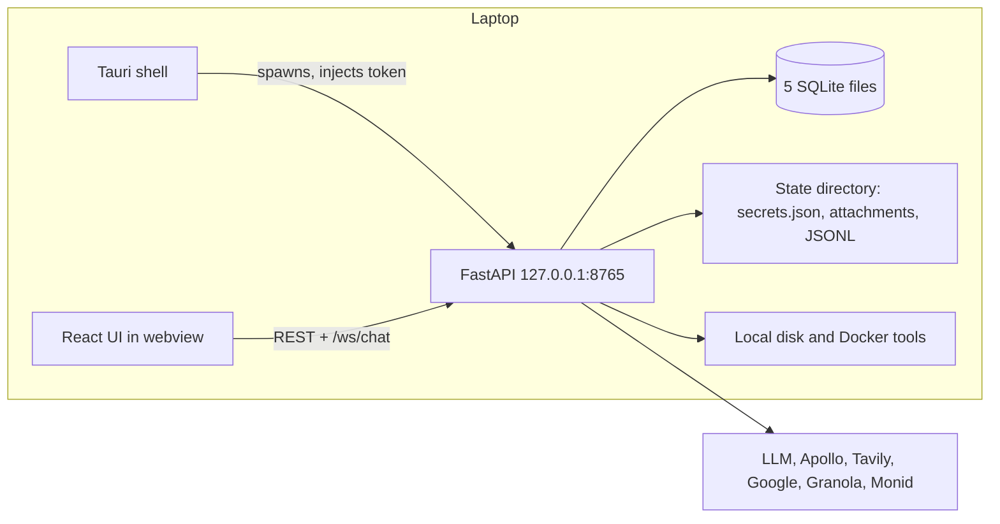
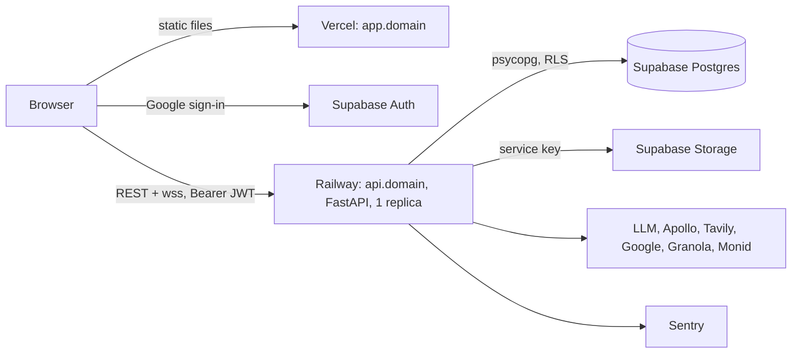

# Hosted migration: local desktop agent to web service

Date: 2026-11-09. Status: decided, not started. Reviewer of record: Fisher.
Reviewed by Codex (`gpt-6-sol`, read-only) on 2026-11-09. The plan holds the review record.
Plan: `docs/superpowers/plans/2026-11-09-hosted-migration-plan.md`.

This spec reverses the guardrail in `AGENTS.md:21` ("Do not reintroduce the hosted app, Postgres, Next.js, or team tenancy without a new product decision"). The guardrail stays in force until ADR 0007 merges (plan, phase 0).

## Terms

| Term | Meaning |
| --- | --- |
| Hosted | The service runs on Vercel, Railway, and Supabase. The user opens a URL. |
| Operator | The person who runs the hosted service. Today this is Fisher. |
| User | A person with an account. Each user sees only their own data. |
| Run | One execution of the agent loop (`backend/coworker/turn.py`). |
| Detached run | A run that continues after the browser closes. |
| Lease | The record that says which process owns a run. |
| RLS | Postgres row-level security. The database refuses rows that belong to a different user. |
| State directory | `~/.config/club`. The local app keeps all data there. |
| Launch gate | A condition that must be true before a second user is invited. |

## Result

| Area | Before (local) | After (hosted) |
| --- | --- | --- |
| Access | Install a Tauri desktop app | Open `app.<domain>` |
| Frontend | React/Vite inside Tauri | The same React/Vite build, static on Vercel |
| Backend | FastAPI child process on `127.0.0.1:8765` | The same FastAPI app, one Railway service, one replica |
| Database | 5 SQLite files, 42 tables, raw SQL | 1 Supabase Postgres database, raw SQL, `psycopg` |
| Users | One operator, no user model | Invite-only accounts, cap of 10, each isolated |
| Login | Shared `X-Club-Token` from the shell | Supabase Auth, Google sign-in, email allowlist |
| Runs | Tied to a live WebSocket | Detached; the browser re-attaches and replays |
| Scheduler | In-process thread; stops when the app quits | In-process thread in an always-on service |
| Secrets | One `secrets.json`, one account | Encrypted per-user rows; platform keys in Railway variables |
| Files | State directory | Supabase Storage and Postgres tables |
| Local tools | `fs_*`, `shell_exec`, folder picker | Removed |

## Goals

1. The agent works while the user's laptop is closed.
2. A user needs no install.
3. Each user's data is isolated in the database, and a test proves it.
4. The operator's provider spend has a hard cap for each user.

## Not goals

- Team workspaces, shared person files, and roles.
- Open signup and billing.
- Google OAuth verification and the security assessment for restricted Gmail scopes.
- A Next.js rewrite. A revival of `archive/hosted-web/`.
- A second runtime. The desktop app stops at the `desktop-final` tag.
- A job queue, Redis, or more than one backend replica.
- A rewrite of the transport to SSE.
- Metrics dashboards and point-in-time database recovery.

## Architecture

Before:



After:



The Railway service holds four things in one process: the REST API, the WebSocket, the runs, and the scheduler. This is sized for 10 users. The per-run budget in `run_budget.py:43-55` is 40 model turns, 120 tool calls, 15 minutes, and 2.00 USD. `MAX_STEPS = 8` in `server.py:221` is defined but not used. One process is a known limit, not an oversight.

## Decisions

Each row names the option that was rejected.

| # | Decision | Rejected | Reason |
| --- | --- | --- | --- |
| 1 | Drivers: always-on agent and zero install. ADR 0007 records the reversal. | Team sharing as a v1 driver | No current user needs it. |
| 2 | Multi-user, isolated. `user_id` on each table from the start. | Single-tenant deploy; team workspaces | Tenancy is the most expensive thing to add later. |
| 3 | Web replaces desktop. Desktop stops at tag `desktop-final`. | Two runtimes; thin desktop shell | Two runtimes double the test matrix. |
| 4 | Port: keep FastAPI and React/Vite. | Revive the archive; rewrite in Next.js | The agent loop, approvals, and ledger are tested Python. |
| 5 | Invite-only, cap of 10 users, no billing. | Open signup | Keeps Google and spend exposure small. |
| 6 | Google OAuth: External, In production, unverified. | Testing status; Internal; verified | Testing expires refresh tokens after 7 days. Verification needs a security assessment. |
| 7 | Supabase Auth, Google sign-in, email allowlist. Identity scopes only at login. | Password login; magic links | One identity provider. Connector scopes are granted separately. |
| 8 | One Postgres database, raw SQL, `psycopg`. | SQLAlchemy; SQLite on a Railway volume | One change at a time is easier to verify. SQLite pins the service to one host and has path-only isolation. |
| 9 | One always-on service, one replica, detached runs, database lease. | Web plus worker with a queue; Redis | Ten users do not need a queue. |
| 10 | Remove workspace file tools, shell tools, and the folder picker. | Per-user sandbox; local companion app | The sourcing job does not need the user's disk. |
| 11 | Platform keys for LLM, Apollo, Tavily. Per-user monthly cap. Monid stays a per-user key. | Users bring all keys | Zero-install needs working keys. The cap is a launch gate. |
| 12 | One-time import script for existing operators. | Continuous sync; start clean | Real person files exist. Sync is a second product. |
| 13 | Two environments: staging and production. | Production only | The service sends real mail. |
| 14 | `app.` on Vercel, `api.` on Railway. Keep REST and WebSocket. | Proxy through Vercel; SSE rewrite | Vercel does not proxy WebSockets. |
| 15 | Tag `desktop-final`, then build hosted on main. No dual persistence flag. | Long-lived branch; runtime flag | One persistence layer at a time. |
| 16 | Application-layer `user_id` filter plus an RLS backstop. Two-user test is a CI gate. | Application layer only; frontend reads Supabase | A missed filter is silent, and the data is mail. |
| 17 | `user_secrets` table, AES-GCM, key in a Railway variable. | Supabase Vault; plain text | A database dump alone does not expose tokens. |
| 18 | Keep the in-process scheduler. One database claim for each job against double firing. | Railway cron; `pg_cron` | Reuses the tested scheduler. |
| 19 | Attachments to Supabase Storage. JSONL and JSON state to tables. Memory mirror removed. | Railway volume | A volume pins the service to one replica. |
| 20 | Remove doctor, local backups, update channel, diagnostic bundle. Supabase daily backups. Forward-only SQL migrations. | Port doctor to Postgres | Managed backups replace it. |
| 21 | Backend tests run on real Postgres only. | Keep SQLite for tests | Two SQL dialects hide bugs. |
| 22 | Merge to main deploys staging. Production needs a manual promote. | Auto-deploy production | Fisher controls releases. |
| 23 | Sentry on backend and frontend, with a scrubber. | No error tracking; metrics stack | Telemetry is in-memory only today. |
| 24 | Data notice, delete-account action, operator-only production access. All are launch gates. | Defer to after launch | The operator can read user mail data. |
| 25 | Parity is the full sourcing job in production. Rollout: Fisher, then the director, then officers. | Invite all at once | Each step tests one new risk. |
| 26 | Six phases; `user_id` is added during the port; hosting comes after auth. | Host first, add tenancy later | Each query changes one time. No unauthenticated service is public. |
| 27 | Deliverables are this spec and the plan. No issues or commits yet. | File issues now | Fisher decides the ticket shape. |

## Authentication and request flow

```mermaid
sequenceDiagram
  participant B as Browser
  participant A as Supabase Auth
  participant R as Railway API
  participant D as Postgres
  B->>A: Google sign-in (openid, email, profile)
  A-->>B: Session with JWT
  B->>R: REST with Authorization: Bearer JWT
  R->>R: Verify JWT, check email allowlist
  R->>D: BEGIN; set app.user_id; query; COMMIT
  D-->>R: Only this user's rows (RLS)
  B->>R: wss /ws/chat, JWT in the subprotocol list
  R-->>B: Replay stored events, then live events
```

Rules:

- The backend verifies the JWT on each REST request and on the WebSocket handshake.
- The WebSocket accepts the token in the `Sec-WebSocket-Protocol` list, as `_ws_token_ok` does today (`server.py:391`). The `?token=` query path is removed, because URLs appear in logs.
- Authentication is one global middleware, as `gate` is today (`server.py:1221`). It is not a per-route dependency, because mounted routers would be missed. The only exceptions are `OPTIONS`, the two OAuth callbacks, and the health route.
- Supabase can create an `auth.users` row at the first Google sign-in, before the backend sees a request. So the allowlist is enforced in two places. A Supabase before-user-created hook checks `allowed_emails` and refuses an email that is not listed; no account is created. The backend check stays, and returns 403, for a user whose access was removed after sign-up.
- The two OAuth callback routes (`/v1/gmail/callback`, `/v1/mcp/oauth/callback`) have no session header. Today each keeps one process-wide pending state (`server.py:2139`, `mcp_oauth.py:105`), so two users who connect at the same time collide. On hosted, each connect attempt is a row in `oauth_pending`: user id, provider, `state`, PKCE verifier, expiry, and a used flag. The callback finds the user from that row only. Callback error pages show fixed text, not the provider's error text.

## Data model

### Changes that apply to all tables

- Each table gets `user_id uuid not null`, with a foreign key to `auth.users(id)` and `ON DELETE CASCADE`. One exception: `allowed_emails` has no `user_id`, because an invited person has no account yet.
- Each unique key that is per user gains `user_id`.
- Each table has RLS enabled and one policy: `user_id = current_setting('app.user_id')::uuid`.
- The backend connects with a role that does not have `BYPASSRLS`. The migration role owns the tables.
- Column types stay as close to SQLite as possible. `TEXT` stays `text`. `INTEGER` becomes `bigint`. No type upgrades in this migration.

### Source databases

| SQLite file | Module | Notes |
| --- | --- | --- |
| `club.db` | `store.py` | Sessions, events, memories, settings, jobs, inbox, chat queue |
| `people.db` | `people.py`, `crm_*` | People, person files, tasks, CRM history |
| `agent_runs.db` | `agent_run_repository.py` | Runs, effects, checkpoints; compare-and-swap writes |
| `drive_ingestion.db` | `drive_ingestion.py` | Drive ingestion jobs and proposals |
| `meeting_evidence.db` | `meeting_evidence.py` | Meeting evidence and candidates |

All five merge into one schema in one database.

### SQL translation rules

| SQLite | Postgres |
| --- | --- |
| `?` placeholders | `%s` |
| `BEGIN IMMEDIATE` (14 sites) | A transaction plus `SELECT ... FOR UPDATE` on the contended row, or a transaction advisory lock. Review each site. |
| `INSERT OR REPLACE` | `INSERT ... ON CONFLICT ... DO UPDATE` |
| `INSERT OR IGNORE` | `INSERT ... ON CONFLICT DO NOTHING` |
| `cursor.lastrowid` | `RETURNING id` |
| `PRAGMA user_version` and the registry in `migrations.py` | Ordered files in `supabase/migrations/` |
| `PRAGMA table_info` column probes | Removed; the migration files define the schema |
| `executescript` | One transaction with separate statements |
| SQLite online backup API | Removed; Supabase backups |

### Lookups that have no user yet

Three operations start with no user id, so they cannot pass a `user_id` policy:

| Operation | What it must find |
| --- | --- |
| OAuth callback | The `oauth_pending` row for a `state` value, and its user |
| Scheduler tick | The due jobs of all users |
| `crm_refresh` loop | The users who have a connected Google account |

Each one is a SQL function that the migration role owns. It is `security definer` with a fixed `search_path`. It returns ids only: a user id and a row id, never content. Postgres lets every role execute a new function by default, so each migration revokes `EXECUTE` from `PUBLIC` and grants it to the backend role only. The functions are in a schema that the Supabase API does not expose. The backend then opens `tx(user_id)` and does the work under RLS. The RLS coverage check holds the list of these functions by name, and tests assert that each one returns no content column and that the Supabase `anon` and `authenticated` roles cannot execute it. Ordinary queries have no such path.

### New tables

| Table | Purpose |
| --- | --- |
| `allowed_emails` | Invite allowlist. Operator-managed. No `user_id`. The backend role can read it and cannot write it. It is the one named exception in the RLS coverage check. |
| `oauth_pending` | One row for each OAuth connect attempt. Expiring and single-use. |
| `user_secrets` | Encrypted per-user grants and keys (Google, Granola, Monid). |
| `user_spend` | Per-user, per-month spend counters for the cap. |
| `transcript_events` (name to confirm in phase 1) | Rows that replace the JSONL transcripts and event logs. |

### State that moves or goes away

| Today | Hosted |
| --- | --- |
| `attachments/` | Supabase Storage, private bucket, backend access only. The backend builds the key as `user_id/attachment_id` from the signed-in user. Today the lookup uses the id alone (`attachments.py:349`). |
| JSONL transcripts and events | Postgres tables |
| `memory/` markdown mirror | Removed; the `memories` table is the source of truth |
| `mcp.json`, user skills | Per-user rows; built-in skills ship in the image |
| `workspace_receipts.jsonl`, `workspace_grants.json`, `shell_tasks.json`, `host_command_approvals.json`, `directory_requests.json`, `workspace_trash/` | Removed with the local tools |
| `agent_run_owners/*.owner` | Removed; the lease is a database row |
| `backend-<port>.token` | Removed; JWT replaces it |
| `state_versions.json`, `backups/` | Removed |
| `logs/backend.log` | stdout to Railway logs |

## In-process state that must become per-user

These are the places where a single-user assumption is in memory, not in the database. Each is a possible cross-user leak.

| Place | Today | Hosted |
| --- | --- | --- |
| `app.state.*` (54 assignments in `server.py`) | One store per process, bound to one state directory | Stateless repositories; each call gets a connection and a `user_id` |
| `app.state.live_event_senders` and `_publish_live_events` (`server.py:3663`) | "Deliver one event to every attached socket" | Deliver only to the sockets of the user who owns the event |
| `RunCoordinator` (`turn.py:614`) | Keyed by session | Keyed by user and session |
| Connectors: `app.state.gmail`, `drive`, `calendar`, `mcp`, `monid`, `crm_refresh` (`server.py:499-532`, `2228`) | One instance, built from one `secrets.json`, passed to every run (`server.py:4014-4026`) | Built for each user from that user's grants, for routes, runs, and scheduled jobs |
| OAuth pending state (`server.py:2139`, `mcp_oauth.py:105`) | One value for the process | `oauth_pending` rows |
| Telemetry adapter (`telemetry/adapters.py:46`) | An unbounded list for the life of the process | Bounded |
| Scheduler `_running` set (`scheduler.py:190`) | Process-local claim | A database claim for each job |
| Browser `localStorage` (session cache, chat drafts, description drafts, follow-up drafts, person editor drafts) | Keys have no user | Keys include the user id; cleared on sign-out |
| Scheduler default job (`run.py:90`) | Seeded once at first start | Seeded for each user at first sign-in |

## Run lifecycle

```mermaid
stateDiagram-v2
  [*] --> running: user sends a message, or the scheduler fires
  running --> waiting_approval: a consequential action needs review
  waiting_approval --> running: user approves or rejects
  running --> complete
  running --> interrupted: deploy or crash; lease expires
  interrupted --> running: user retries
  complete --> [*]
```



- A run starts from a WebSocket command or from the scheduler. The process owns the task. The socket does not.
- If the browser closes, the run continues. Events go to the database.
- When the browser opens again, the server replays stored events and then sends live events. The replay code exists (`server.py:4175`).
- The offline parking of the chat queue (`mark_queue_offline`, `server.py:4090`) is removed for the no-window case.
- The lease is a database row with an owner id and an expiry. A heartbeat extends it. This replaces `fcntl.flock` in `agent_run_owner.py`. The compare-and-swap writes in `agent_run_repository.py` stay.
- On start, the service runs the existing restart reconcile. It marks orphaned runs as interrupted and quarantines dispatched effects that have no report. It does not resume runs automatically. Resume is not wired in today (`agent_run_resume.py:23`), and this migration does not add it.
- A deploy interrupts active runs. The user sees "interrupted" and retries. This is accepted for v1.
- Approval before send does not change. No auto-send. Scheduled sessions stay read-only.

## Scheduler

- The 30-second tick stays in the Railway service. Each tick reads due jobs for all users.
- A job runs only after a database claim on its row. The tick and "Run now" use the same claim. This replaces the process-local set in `scheduler.py:190`. A second replica that starts by mistake cannot fire the same job. A claim expires, so a crash does not block the job.
- The job runner sets the user context before it runs a job.
- `crm_refresh` runs for each user who has a connected Google account. A failure for one user does not stop the others.

## Connectors and Google OAuth

- Publishing status: External, In production, unverified. Users see the "unverified app" warning.
- Limit: 100 new users for the lifetime of the Google Cloud project. The limit cannot be reset. Staging and production use separate projects so that test accounts do not use the production limit.
- Redirect URIs: `https://api.<domain>/v1/gmail/callback` and `https://api.<domain>/v1/mcp/oauth/callback`. `PUBLIC_URL` sets the base.
- The backend no longer opens a browser with the macOS `open` command (`server.py:357`, `mcp_oauth.py:33`). It returns the authorization URL. The frontend navigates to it.
- Gmail scope classes, from Google's scope page: `gmail.readonly`, `gmail.modify`, `gmail.compose`, and `gmail.metadata` are restricted. `gmail.send` is sensitive.
- Tokens are not migrated from local installs. Each user connects again.

## Secrets and configuration

Names only. Values live in Railway variables and Vercel environment variables. No value goes in the repository, a commit, or a log.

| Where | Names |
| --- | --- |
| Railway | `DATABASE_URL`, `SUPABASE_URL`, `SUPABASE_SERVICE_ROLE_KEY`, `SUPABASE_JWT_*` (exact form to confirm), `SECRETS_ENCRYPTION_KEY`, `PUBLIC_URL`, `ALLOWED_ORIGINS`, `SENTRY_DSN`, `GOOGLE_OAUTH_CLIENT_ID`, `GOOGLE_OAUTH_CLIENT_SECRET`, `DEEPSEEK_API_KEY`, `MOONSHOT_API_KEY`, `APOLLO_API_KEY`, `TAVILY_API_KEY`, `CLUB_MODEL`, `USER_MONTHLY_CAP_USD` |
| Vercel | `VITE_CLUB_HTTP`, `VITE_SUPABASE_URL`, `VITE_SUPABASE_ANON_KEY`, `VITE_SENTRY_DSN` |
| Per user, encrypted in `user_secrets` | `google`, `gmail`, `mcp-oauth:granola`, `monid` |

## Security requirements

1. **Isolation.** Each query filters by `user_id`. RLS is the backstop. The backend role cannot bypass RLS.
2. **Two-user gate.** One test calls each route as user A and asserts that no row of user B returns. The test reads the route list from the app. A route with no case fails the test.
3. **RLS coverage check.** A CI check queries the catalog. Each table in the application schema must have RLS enabled and a policy.
4. **Local tools removed before the first deploy.** `shell_exec` must not be reachable on a public host.
5. **Token encryption.** AES-GCM, key in `SECRETS_ENCRYPTION_KEY`, never in the database.
6. **CORS and origins.** The allowlist comes from `ALLOWED_ORIGINS`. The localhost regex (`server.py:211`) and the hardcoded list (`server.py:1207`) are removed. The loopback bind refusal (`run.py:83`) is removed.
7. **Logging.** No tokens, authorization headers, or mail bodies in logs or Sentry. A test proves the scrubber.
8. **Storage.** The attachments bucket is private. Only the backend holds the service key. The frontend never gets it.
9. **Request limits.** A size limit on request bodies and on WebSocket frames. A limit on concurrent runs for each user. Today only attachment uploads have a limit (`attachments_api.py:43`).
10. **Browser state.** `localStorage` keys include the user id and are cleared on sign-out.
11. **Supabase public API.** RLS with a `user_id` policy means the anon and authenticated keys expose no other user's rows. The frontend uses Supabase for login only.

## Spend cap

- Platform keys pay for the LLM, Apollo, and Tavily.
- `user_spend` holds one counter for each user and month.
- The cap covers each call that spends on a platform key: LLM requests, `web_search` (Tavily), `apollo_search_people`, and Apollo enrichment.
- The check is a reservation of the maximum that the call can cost, not an estimate. For a model request, the maximum is the price of the input tokens plus the price of the output-token limit of the request. For a search or an enrichment, it is the fixed price of one call. One SQL statement adds the maximum to the counter only if the total stays under the cap. Two calls at the same time cannot both pass. Today the cost is recorded after the request (`turn.py:1486`), which is not a cap.
- After the call, the backend replaces the reservation with the real amount, which cannot be more than the maximum. A call that fails before it reaches the provider releases its reservation. A reservation that is never settled, for example after a crash, is settled at its maximum when it expires.
- A model with no price entry cannot run on a platform key, because the cap cannot bind on it.
- At the cap, the call does not run, and the user sees a clear message.
- The per-run budget in `run_budget.py` stays. The monthly cap is a second, wider limit.
- This is a launch gate.

## Data import

- A script, run by the operator, for one state directory and one user email.
- Imports: people, person files, tasks, CRM history, memories, and chat transcripts. A transcript refers to attachments by id, and the bytes are in `attachments/`. The script imports each attachment that an imported transcript refers to, with its metadata, into Storage.
- Skips: active runs, queues, workspace grants, and all tokens.
- It has a dry-run mode and prints row counts for each table. A second run does not duplicate rows.

## Environments and deploy

| | Staging | Production |
| --- | --- | --- |
| Supabase project | 1 | 1 |
| Railway environment | 1 | 1 |
| Google Cloud project | 1 | 1 |
| Vercel | Preview deploys | Production deploy |
| Deploy trigger | Merge to main | Manual promote by Fisher |

Order in each deploy: tests, then database migrations, then the Railway release, then Vercel. Migrations are forward-only. Local development uses the Supabase CLI.

## Launch gates

No second user is invited until each line is true.

- [ ] Two-user gate and RLS coverage check are green in CI.
- [ ] Local file and shell tools are not in the deployed image.
- [ ] Per-user tokens are encrypted, and the key is not in the database.
- [ ] The monthly spend cap stops a call in a test and on staging, and two concurrent calls cannot both pass at the limit.
- [ ] A Google account that is not on the allowlist cannot create an Auth user.
- [ ] The data notice shows at first sign-in.
- [ ] Delete-account removes the allowlist entry, the Google grant, the files, the Supabase Auth user, and all rows. The old identity cannot sign in again.
- [ ] Sentry receives a test error, and the scrubber test passes.
- [ ] Parity run passes in production: name a target, find people, draft, enrich, approve and send, file a reply, and one scheduled run completes with the browser closed.
- [ ] A Google refresh token on staging still works after 8 days.

## Removed features

| Feature | Files | Reason |
| --- | --- | --- |
| Workspace file tools | `workspace.py`, `workspace_files.py`, `workspace_runtime.py`, `workspace_policy.py`, `workspace_audit.py` | Decision 10 |
| Shell tools and host Docker | `workspace_shell.py` | Decision 10 |
| Folder picker | `frontend/src/api.ts:2337` | Tauri only |
| Tauri shell | `frontend/src-tauri/` | Decision 3 |
| Packaging and frozen backend | `backend/packaging/`, macos-preview CI job | Decision 3 |
| Update channel | `backend/coworker/update_channel/` | Decision 20 |
| Doctor and local backups | `doctor.py`, `migrations.py` | Decision 20 |
| Diagnostic bundle | `diagnostic_bundle.py`, `bundle_redaction.py` | Decision 20 |
| Parent-death watcher, tray, single instance | `run.py:15-40`, `lib.rs` | No shell |

ADR 0002 (workspace runtime) and ADR 0003 (macOS packaging) become superseded.

## Measured size of the work

These are counts from the repository on 2026-11-09. They are not time estimates. No time estimate was made.

| Item | Count |
| --- | --- |
| SQLite database files | 5 |
| Distinct tables (`CREATE TABLE`) | 42 |
| Modules that import `sqlite3` | 10 |
| `BEGIN IMMEDIATE` sites | 14 |
| `PRAGMA` uses | 29 |
| REST routes in `server.py` | 97 |
| `app.state.*` assignments | 54 |
| Frontend call sites that set `X-Club-Token` | about 50 |
| Backend test files that use temporary local state | about 137 of 161 |

## Risks and unverified items

| # | Item | Status | Check |
| --- | --- | --- | --- |
| 1 | Refresh-token lifetime for an unverified In-production app. Google's pages state the 7-day rule for Testing only. They do not state it for In production. | Not verified | Hold one staging grant for 8 days (launch gate). |
| 2 | The 100-user limit is for the lifetime of the project. | Read on Google's page | Separate projects for staging and production. Do not test with spare accounts on production. |
| 3 | Growth past the cap needs restricted-scope verification and a security assessment. Cost and duration are not researched. | Open | Research before user 50. Not in this migration. |
| 4 | Network path from Railway to Supabase Postgres (IPv4 or IPv6, direct or pooler) and the `psycopg` settings for the pooler. | Not verified | Phase 3, first task. |
| 5 | The current Supabase JWT verification method (shared secret or signing keys). | Not verified | Phase 2, first task. Read the current Supabase docs. |
| 6 | Supabase plan terms: daily backups and no project pause need a paid plan, as far as I know. | Not verified | Confirm before production is created. Cost is not estimated. |
| 7 | Python 3.14 base image on Railway. CI uses 3.14. | Not verified | Phase 3. |
| 8 | Locking behavior differs between SQLite and Postgres at the 14 `BEGIN IMMEDIATE` sites. | Known risk | The lease and restart tests (`test_agent_run_leases.py`, `test_agent_run_restart.py`) must pass on Postgres. |
| 9 | A deploy interrupts active runs. A run can last 15 minutes, so a deploy cannot wait for it. | Accepted | The user retries. Promote production at quiet times. |
| 10 | One replica is a single point of failure. | Accepted | Railway restarts the service. No second replica in v1. |
| 11 | The working tree has uncommitted changes in 12 files. | Open | Land them before the `desktop-final` tag. |
| 12 | The domain name is not chosen. | Open | Fisher picks it before phase 3. |
| 13 | The course material in `docs/course/` describes the local app. | Open | The cohort uses the `desktop-final` tag. Course updates are not in this migration. |
| 16 | The Supabase before-user-created hook and its behavior for Google sign-in. | Not verified | Phase 2, first task. Read the current Supabase docs. |
| 14 | No tool fetches a user-supplied URL from the server today. `web_search` sends a query to Tavily. | Checked in `tools.py` and `web.py` | If a URL-fetch tool is added later, it needs a guard against requests to private addresses. |
| 15 | No rate limit by IP address. All routes except the two callbacks and the health route need a valid token for an allowed email. | Accepted for 10 invited users | Add before open signup. |

## Cut order

If time runs short, cut from the top.

1. Sentry on the frontend. Keep the backend.
2. Import of chat transcripts. Keep the import of people, tasks, and CRM history.
3. User skills and per-user MCP configuration. Ship built-in skills and Granola only.
4. Drive ingestion on hosted. It can follow after launch.

Never cut: the two-user gate and RLS, removal of shell tools before deploy, token encryption, the spend cap, and approval before send.
